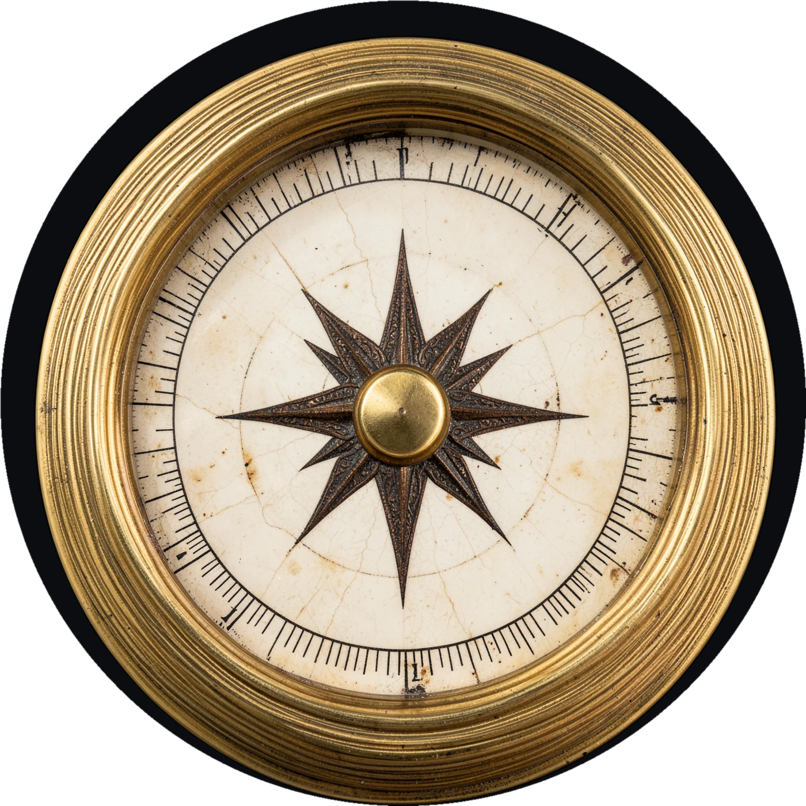
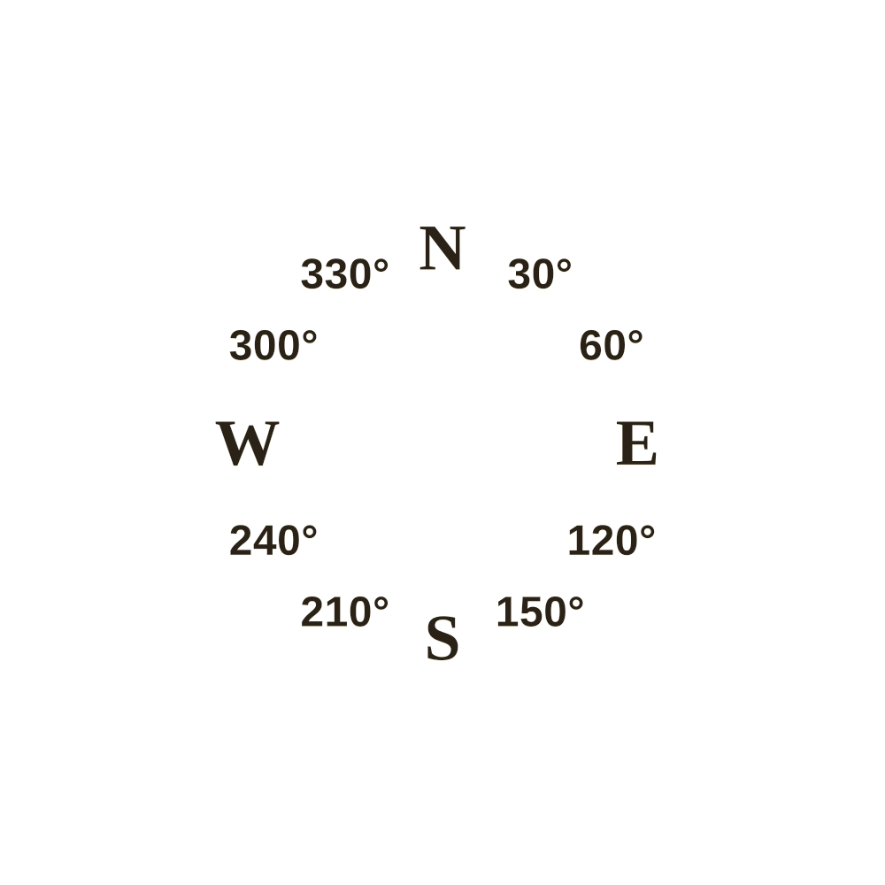
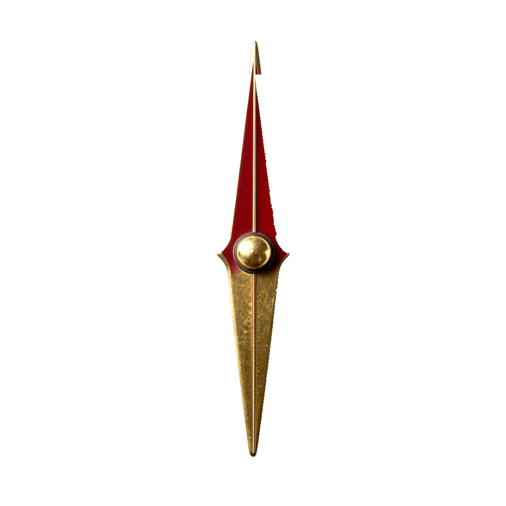
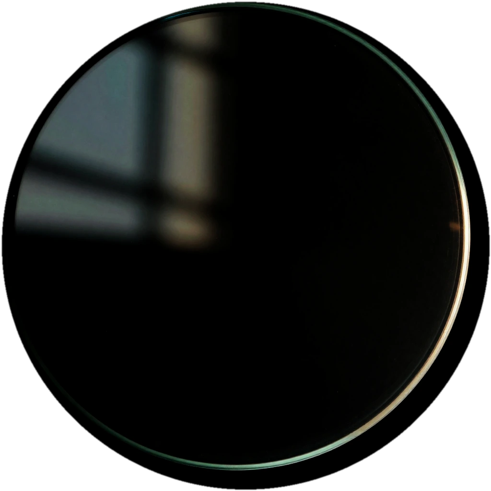
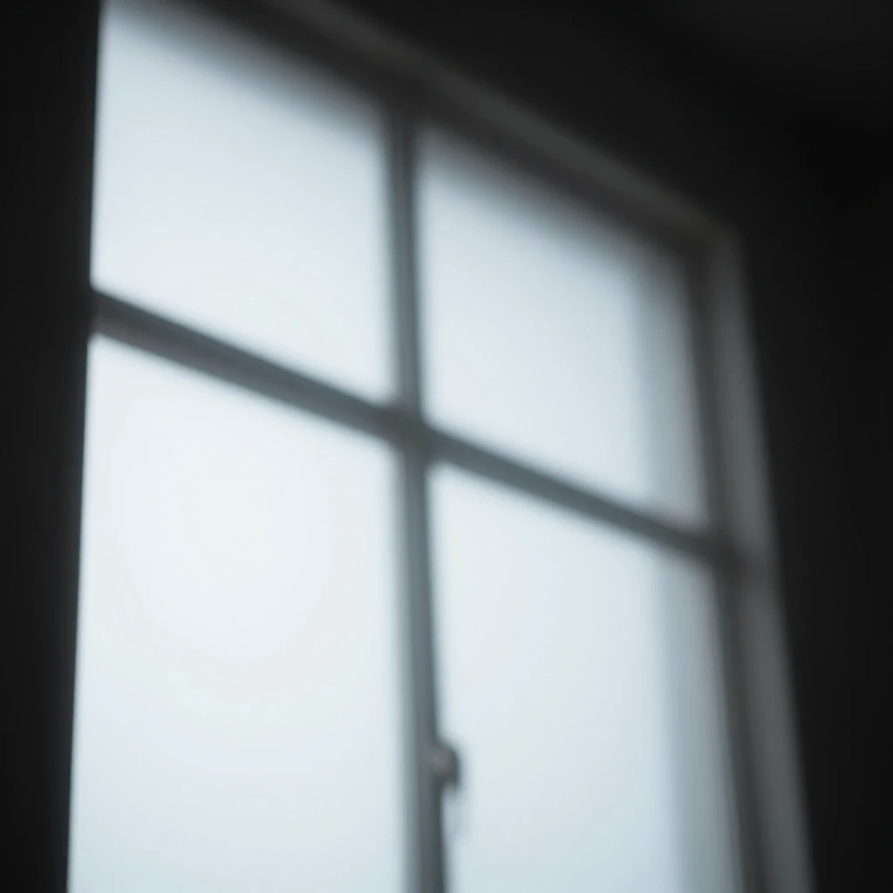
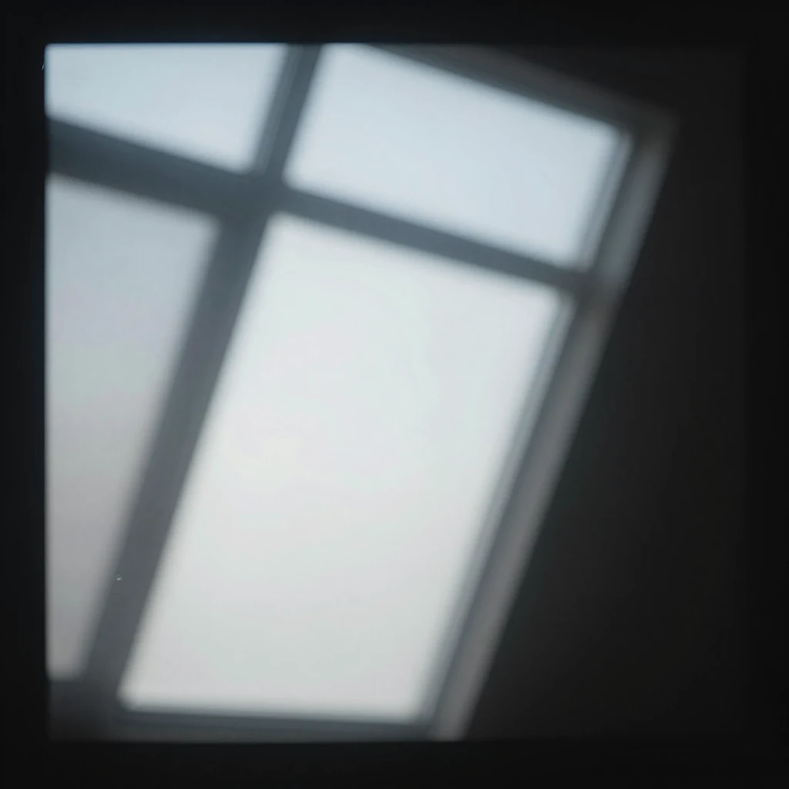

# Compass kit — tech notes

A layered, photoreal compass for 问心. The plate, needle and glass are
model-rendered; every letter and number is vector. The demo composes them in
CSS and drives the glass reflection from the heading.

**The one rule: the image model never draws text.** FLUX.2 Klein and Z-Image
Turbo both invent, duplicate and misplace dial characters. The plate in this
kit is deliberately text-free; `dial-markings.svg` is the only text layer, so
N/E/S/W and the 30° numerals are exact at every size.

---

## Files

```
compass-kit/
├── demo.html                  interactive layered compass
├── TECH.md                    this file
├── README.md                  quick start
└── assets/
    ├── plate.png              1400×1400 RGBA  text-free plate, circular matte
    ├── needle.png             1024×1024 RGBA  pivot at exact centre
    ├── glass.png              1024×1024 RGBA  screen-blend reflection
    ├── sheen-window.png       1024×1024 RGB   window sheen
    ├── sheen-soft.png         1024×1024 RGB   soft sheen
    ├── dial-markings.svg      1000×1000      exact vector labels
    ├── preview.png            1400×1400      flattened demo pose
    ├── geometry.json          measured numbers
    └── web/                   WebP shipping derivatives
```

The raw Draw Things renders stay in `../graphics/` and are not shipped.

---

## Geometry

All values are measured by `scripts/process-compass.py` and written to
`assets/geometry.json`.

| Asset | Size | Key measurements |
|---|---|---|
| plate | 1400 × 1400 RGBA | centre 700, 700 · dial radius **385.76** · dial/plate ratio **0.5511** · source centre 766.11, 750.21 |
| needle | 1024 × 1024 RGBA | pivot **512, 512** · length ratio **0.8218** of the image |
| glass | 1024 × 1024 RGBA | circular alpha · screen blend |
| sheen-window | 1024 × 1024 RGB | screen blend |
| sheen-soft | 1024 × 1024 RGB | screen blend |
| markings | viewBox 1000 | dial radius **275.54** · label radius **220.43** · cardinals 74 px · numerals 48 px |

Derived for the demo:

- **Dial diameter** = 0.5511 × stage. The glass and sheen layers are inset
  `(1 − 0.5511) / 2 = 22.4%` so the crystal covers the dial, not the bezel.
- **Needle box** = 63.8% of the stage (`inset: 18.1%`). That gives a needle
  length of 0.8218 × 0.638 = **0.524** of the stage, just inside the 0.551
  dial diameter.
- **Label ring** sits at 0.80 of the dial radius. The cardinals and numerals
  share one ring, clockwise from N. The rose points stay inside it.
- The plate crop is square around the brass hub, so the needle pivot, the
  marking ring and the dial share one centre. The bezel is a little eccentric
  in the source; the circular matte leaves a dark ring at one side (see
  *Known limits*).

---

## Layer stack

| z | Layer | Transform | Blend / note |
|---|---|---|---|
| 0 | well | — | dark disc behind the plate; hides the matte ring |
| 1 | plate + markings | `rotate(-heading)` | the dial is one rigid card; text rotates with it |
| 2 | needle | `rotate(target − heading)` | pivot at the hub |
| 3 | glass | texture `rotate(-heading)` | `screen`, opacity .62, inset to the dial |
| 4 | sheen-window | `rotate(-0.58 × heading)` + drift | `screen`, opacity ≈ .10 ± .025 |
| 4 | sheen-soft | `rotate(-1.22 × heading)` + drift | `screen`, opacity ≈ .07 ± .015 |
| 5 | glints | `rotate(-heading)` | two small specular spots, `screen` |
| 6 | lubber | none | fixed top index; amber, green when aligned |
| 7 | align ring | none | green halo when on target |

The **lubber index is not in the SVG**. It belongs to the case, fixed to the
phone, so it must not rotate with the dial. The demo draws it separately.

### Why the reflection turns the other way

When the phone turns right, the world — and a window reflected in the
crystal — appears to turn left. The glass texture therefore rotates by
`−heading` while the dial rotates by `−heading` too; the *needle* is the only
element that follows the target rather than the world.

The two sheen layers rotate at 0.58× and 1.22× to fake two reflecting
surfaces with parallax. Their opacity is modulated by `cos(heading)` so the
reflection brightens and dims as the light angle changes. This is a visual
approximation, not physical optics.

---

## Compass math

```js
const norm360 = (d) => ((d % 360) + 360) % 360;
const signed  = (from, to) => ((to - from + 540) % 360) - 180;

const relative = signed(heading, target);   // −180 … +180
dial.style.transform   = `rotate(${-heading}deg)`;
needle.style.transform = `rotate(${relative}deg)`;

const aligned = Math.abs(relative) <= 3;
```

A positive relative bearing means the target is clockwise from the phone's
top: turn right. The verdict text uses the same number.

Smoothing in the demo keeps a continuous angle and moves toward the nearest
equivalent (`signed()`), so crossing 0°/360° never spins the long way.

---

## The fake glass

The generated glass is a dark disc with a window pane and a thin rim
highlight. Used raw at full strength, screen blending washes the cream dial
white. The pipeline prepares it for screen blending:

1. Crop the disc and apply a circular alpha.
2. Lift the black point: `(rgb − 0.25) / 0.75`.
3. Gamma-crush the broad pane so it does not hide the markings: `^ 1.6`.
4. In CSS: `mix-blend-mode: screen; opacity: .62;` and inset the glass to the
   dial.

The rim highlight survives the curve; the window pane becomes a soft
reflection. The demo's *Reflection follows heading* switch freezes every
glass transform at 0° so the difference can be inspected.

Tuning points, in order of effect:

- glass opacity (`.glass`, currently .62)
- glass gamma and black point (`process_glass`)
- sheen opacities and parallax factors (`REFLECT` in the demo)
- glint position/size/opacity

Everything is a CSS transform on a composited layer; there is no canvas and
no per-frame image work. The demo updates one custom property per frame and
lets the compositor rotate the layers.

---

## Mobile sizes

The stage is `min(100%, 330px)`; the panel content is 316 px at a 390 px
viewport and 330 px at 430 px. The dial is 55.1% of the stage, the numerals
are 48/1000 of the stage, and the cardinals 74/1000.

| Stage | Dial diameter | 30° numerals | Cardinals | Use |
|---|---|---|---|---|
| 250 px | 138 px | **12.0 px** | 18.5 px | today's in-game size on a 390 px phone |
| 290 px | 160 px | **13.9 px** | 21.5 px | recommended minimum |
| 316 px | 174 px | **15.2 px** | 23.4 px | demo at 390 px |
| 330 px | 182 px | **15.8 px** | 24.4 px | demo at 430 px |

The current game rule is `min(64vw, 290px)`, which is 249.6 px on a 390 px
phone. The numerals land just under 12 px. **Ship the compass at 290–330 px**
(or drop the 30° numerals at 250 px and keep only the cardinals). The needle,
cardinals and target readout still work at 250 px; the numerals are the part
that crosses the floor.

Tap targets in the demo: 44 × 44 px minimum for buttons, chips, segmented
controls and slider rows; labels ≥ 13 px; body 16 px.

---

## Demo

Open directly:

```bash
open -a "Google Chrome" compass-kit/demo.html
```

Or serve the repo and use `http://localhost:8000/compass-kit/demo.html` if
you need the sensor APIs or are loading from another folder.

### Controls

- **Heading / Target** sliders: the two compass inputs.
- **Spin**: one full turn in 3.6 s; the button becomes **Stop**.
- **Face target**: sets heading = target, so the needle points at the lubber.
- **Use phone compass**: requests iOS motion permission, then listens to
  `deviceorientationabsolute` / `deviceorientation`. It shows a plain-language
  fallback if the API, permission or reading is missing. Dragging a slider or
  pressing Spin/Face stops the sensor.
- **Layers**: Plate, Markings, Needle, Glass, Sheen. Each chip hides exactly
  that layer; Glass also hides the glints.
- **Reflection follows heading**: freezes/unfreezes the glass transforms.
- **Theme / Width**: dark/light and 390 / 430 / Full preview widths.

### URL parameters

All parameters are optional and make screenshots deterministic.

| Parameter | Values | Effect |
|---|---|---|
| `h` | 0–359 | heading |
| `t` | 0–359 | target bearing |
| `theme` | `dark`, `light` | theme override |
| `frame` | `390`, `430`, `full` | preview column width |
| `layers` | `plate,markings,needle,glass,sheen` | only these layers on |
| `reflection` | `0` | freeze the glass |
| `stage` | number ≥ 120 | stage size in px (clean captures) |
| `view` | `clean` | hide all UI except the compass |

Example clean capture (used for `assets/preview.png`):

```
demo.html?view=clean&stage=1200&theme=dark&h=25&t=110
```

### Verification

Checked in Chrome 155 at true 390 × 844 and 430 × 932 CSS viewports, dark and
light, with headless CDP screenshots:

- 390: stage 316 px, dial 174 px, numerals 15.2 px; the primary sensor button
  is above the 844 px fold.
- 430: stage 330 px, dial 182 px, numerals 15.8 px.
- Face target → heading 110°, verdict “On target”, align ring on.
- Spin → heading advances, label changes to Stop, then returns to Spin.
- Glass/Sheen layer toggles hide the right elements.
- Reflection switch → `--glass-rot: 0deg` and sheen offsets 0.
- Theme, width and URL-parameter paths all update the page.
- Sensor path in headless Chrome falls back to “No compass reading. Use the
  slider.” after 2.4 s. A real-device heading was not available in this
  environment; test on an HTTPS page on iOS before ship.

---

## Regeneration

### Models and settings

- **Plate:** `flux_2_klein_4b_i8x.ckpt`, 4 steps, guidance 1, guidance embed
  3.5, DDIM Trailing, shift 3, 1536 × 1536, batch 2.
- **Needle / glass / sheens:** `z_image_turbo_1.0_i8x.ckpt`, 8 steps, guidance
  1.0, UniPC Trailing, 1024 × 1024, batch 2.

Draw Things is left configured in the app; `scripts/dt-batch.mjs` sends only
prompt, size, negative prompt (if present) and batch count. It saves every
image the API returns, not just the first.

```bash
# final text-free plate (2 candidates)
node scripts/dt-batch.mjs graphics/compass-manifest-flux-rose.json

# needle, glass and sheens (Z-Image model loaded)
node scripts/dt-batch.mjs graphics/compass-manifest-v2.json

# rebuild every derived asset and geometry.json
python3 scripts/process-compass.py
```

The final plate prompt is in `graphics/compass-manifest-flux-rose.json`. Its
requirements, in order of importance:

1. top-down, perfectly circular, centred, isolated on pure black;
2. a wide polished brass bezel with concentric grooves and patina;
3. a fine tick ring at the dial edge;
4. an engraved eight-point rose confined to the central half;
5. **a wide blank outer ring**, reserved for printed markings — the prompt
   never asks the model to print anything.

### What was tested and rejected

- `flux-plate-a` / `flux-plate-b` asked for the full N/E/S/W + 30° ring. FLUX
  rendered some correct letters, but duplicated W, misplaced N/S, and turned
  the numerals into 35, 20, 90, etc. Not shippable.
- `flux-plate-clean` is text-free but has a very small rose.
- `flux-plate-rose-02` has stray marks at 12 and 9 o'clock; **rose-01** is the
  clean candidate used here.
- Gemini's consumer Images mode (Flash-Lite and 3.6 Flash) returned “image
  creation may not be available in your location” from the UK. No image was
  produced. The vector-text route does not depend on it.

The Z-Image plate path remains in `process-compass.py` as `PLATE_MODE =
'zimage'` for reference, but the shipped markings are tuned to the FLUX
plate's wider margin (no halos).

---

## Pipeline notes

`scripts/process-compass.py`:

- **Plate:** finds the brass hub by gold colour, crops a square around it,
  builds a circular alpha, recolours pure-black background to `#0b0d10`, and
  measures the dial by the cream fraction: the fraction stays near 1.0 inside
  the dial and drops at the tick ring. The last radius above 0.92 is the dial
  radius.
- **Needle:** keys a saturation/dark-edge mask, mirrors the clean left
  silhouette across the gold-dome centreline to remove the neutral cast
  shadow, fills small specular holes, finds the widest row as the pivot, and
  crops 1100 → 1024. The white highlight at the tip is intentional
  (specular).
- **Glass:** crops the disc, circular alpha, black-point lift and gamma as
  described above.
- **Sheens:** copied from the two raw window renders; screen-ready.
- **Markings:** generated as SVG text. Georgia for cardinals, Helvetica/Arial
  for numerals, dark ink `#2b2116`, 74/48 px, one ring at 0.80 of the dial
  radius, no halo.
- **Web:** WebP q90 for the plate, q92 for needle/glass, q88 for sheens.

PNG masters are 1400 / 1024 and remain in `assets/` for scaling and for tools
that cannot read WebP. The demo uses WebP with PNG `<picture>` fallbacks.

---

## Integration into the game

The existing `game.js` draws the compass into a canvas (`drawCompass`,
`buildDial`). The kit replaces the dial with DOM layers; the sensor and state
logic stay as they are.

Minimal structure:

```html
<div class="compass">
  <div class="stage">
    <div class="dial">
      
      
    </div>
    
    
    <div class="sheen sheen-window"></div>
    <div class="sheen sheen-soft"></div>
    <div class="lubber">…fixed top index…</div>
  </div>
</div>
```

```css
.stage { position: relative; aspect-ratio: 1; isolation: isolate; }
.dial   { position: absolute; inset: 0; transform: rotate(calc(var(--h) * -1deg)); }
.needle { position: absolute; inset: 18.1%; transform: rotate(calc(var(--rel) * 1deg)); }
.glass  { position: absolute; inset: 22.4%; mix-blend-mode: screen; opacity: .62;
          transform: rotate(calc(var(--h) * -1deg)); }
.sheen  { position: absolute; inset: 22.4%; border-radius: 50%; overflow: hidden;
          mix-blend-mode: screen; }
```

```js
const rel = ((target - heading + 540) % 360) - 180;
stage.style.setProperty('--h', heading);
stage.style.setProperty('--rel', rel);
```

Practical notes:

- Keep `isolation: isolate` on the stage, otherwise `mix-blend-mode: screen`
  blends with the page background.
- Size the stage to 290–330 px on phones. The demo caps at 330 and fills a
  390 px panel at 316.
- The plate's matte background is `#0b0d10`. If the game panel is a different
  colour, keep a dark well behind the plate (as the demo does) or recolour the
  plate background in the pipeline.
- Preload the plate, needle and glass before the first compass frame; the
  demo waits on `img.decode()` and fades the whole stage in. Do not fade
  individual layers: a layer-level opacity rule overrides the glass/sheen
  opacities.
- The lubber index and the green alignment ring are UI layers, not assets.
- The top fixed index is the phone's forward direction. Do not rotate it.
- The existing sensor code (`webkitCompassHeading`, `deviceorientationabsolute`)
  can feed `heading` unchanged.

---

## Known limits

- **The model cannot draw the ring.** Do not reintroduce generated text.
  Convert the SVG text to paths if you need identical typography on every
  Android/iOS browser; Georgia and Helvetica fall back differently.
- **The bezel is slightly eccentric and rotates with the dial.** The source
  plate is a single image: bezel, dial and rose. Rotating it turns the baked
  upper-left lighting with it, which a real fixed light would not do. The
  eccentricity is small; the circular matte leaves a dark ring that the demo
  hides in a dark well. For a physically fixed bezel, split the plate into a
  bezel layer and a dial-card layer (or re-render with a centred bezel).
- **The glass is a faked 2D reflection.** It is a rotating texture with
  parallax sheens, not view-dependent optics. The window pane can cross a
  numeral at some headings — real glass does this; the *Reflection follows
  heading* switch shows the frozen state.
- **The needle's white tip highlight is baked in.** It is a specular, not a
  matte error.
- **Fonts.** The SVG uses system Georgia/Helvetica; Android substitutes. Test
  on a real Android phone. Converting text to paths is the safest next step.
- **Motion access** requires HTTPS (or localhost) and a user gesture on iOS;
  opening the demo from `file://` cannot grant it.
- **WebP + `mix-blend-mode`** need a modern browser (Safari 15.4+, Chrome 105+
  for the chip `:has` styling; the chips still toggle without `:has`).
- **Preview** is a convenience render at heading 25°, target 110°; it is not
  loaded by the demo.
- The dark well is deliberate. On a light page the compass sits in a black
  disc; if that is not wanted, recolour the plate background to the page
  colour and remove the well.

---

## Asset inventory

| File | Bytes |
|---|---|
| `assets/plate.png` | 2,918,459 |
| `assets/needle.png` | 125,777 |
| `assets/glass.png` | 475,770 |
| `assets/sheen-window.png` | 789,390 |
| `assets/sheen-soft.png` | 735,934 |
| `assets/dial-markings.svg` | 1,230 |
| `assets/preview.png` | 2,449,834 |
| `assets/geometry.json` | 2,172 |
| `assets/web/plate.webp` | 372,064 |
| `assets/web/needle.webp` | 26,888 |
| `assets/web/glass.webp` | 32,632 |
| `assets/web/sheen-window.webp` | 16,846 |
| `assets/web/sheen-soft.webp` | 19,898 |
| `assets/web/preview.webp` | 308,852 |

Demo payload (five layers, WebP): **468,328 B ≈ 457 KB**. With the preview,
759 KB. The preview is not requested by the demo.

---

## Credits and references

- Visual references: `reference/compass-ref1.avif` (brass/stone medallion) and
  `reference/compass-ref2.webp` (pocket compass and degree ring).
- Rendered in Draw Things with FLUX.2 Klein 4B and Z-Image Turbo.
- The plate was rendered text-free; all dial text is `dial-markings.svg`.
- Demo typography follows the project's type scale; the compass itself uses
  instrument-scale numerals (15–16 px at shipping size), not body copy.
